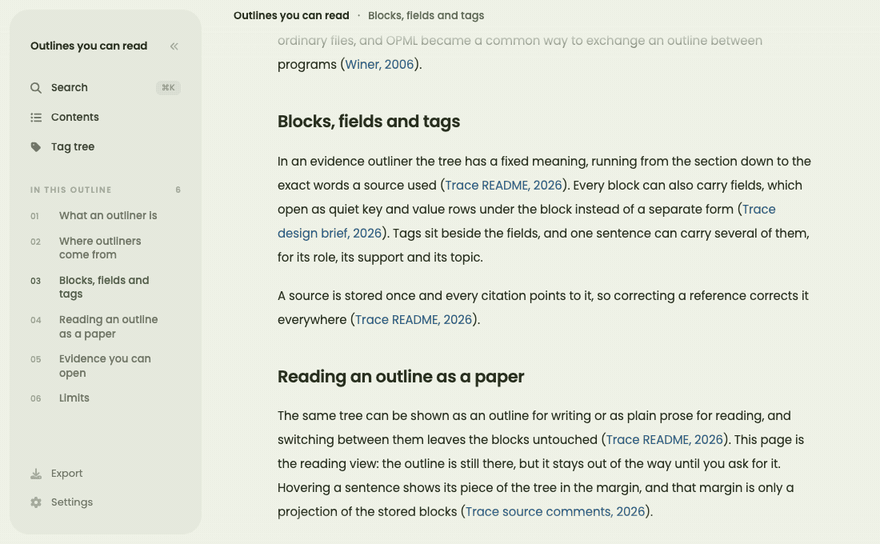

# TraceCite

TraceCite is a format for documents whose sentences open to the evidence behind them. Click a sentence and the source's exact words open in place, with the passage they sit in, notes, tags and who checked them.

<p align="center"><a href="https://prajwalsouza.github.io/TraceCite/"></a></p>

## Try it

- **See it:** [prajwalsouza.github.io/TraceCite](https://prajwalsouza.github.io/TraceCite/) is itself a TraceCite document about TraceCite: click any sentence. More examples are linked from it.
- **One file, nothing to install:** download [`trace-reader.html`](https://github.com/prajwalsouza/TraceCite/releases/latest/download/trace-reader.html) from the latest release, open it in a browser, and drop a `.trace.zip` on it. Try it with [`outliners.trace.zip`](https://github.com/prajwalsouza/TraceCite/releases/latest/download/outliners.trace.zip). Or use the [hosted reader](https://prajwalsouza.github.io/TraceCite/references/trace-reader.html).

Every release attaches both files automatically.

**See what a document looks like inside:** [a sample that uses every part](docs/sample.md). It covers the [`.trace.json`](docs/sample/sample.trace.json), its BibTrace [`.bib`](docs/sample/sample.bib), and the layout of a `.trace.zip`.

**Writing with an AI agent?** Point it at [`llms.txt`](llms.txt) and the [writing guide](docs/writing-with-agents.md).

## The reading page

Read the document as normal prose. Click a sentence to open its evidence just below it. See the source's exact words, their location and the full passage around them. Notes, tags and provenance show what each part means and who added or checked it.

A sidebar holds search, contents, a tag tree and settings. Hover over a tag to highlight related sentences, or pin it to keep them in focus. Readers can change fonts, colours and citation styles. Long documents can load in parts. These reading choices stay in the browser; they do not edit the document.

**Import and export.** Drop a document anywhere on any reading page to open it: a `.trace.zip`, or a `.trace.json` with its `.bib`, scripts and images. The page shows each stage as it reads, unzips and prepares the file, then replaces the current document, with a way back. **Export**, just above Settings, downloads the document as a `.trace.zip`. Settings → Document holds Import, Export and the version history.

## Packages and the reader

A TraceCite package is a plain zip: a `manifest.json`, the trace data, its BibTrace `.bib` files, figure images and any interactive scripts. The manifest keeps a version history: each version's date, author, note and a content hash, with the previous hash. Every reading page carries its package and prepares it in the browser.

`trace-reader.html` is one standalone file that opens any package and does all the preparation itself: sources, maths, cross-references, citation styles and interactives. Drop a `.trace.zip` on it, choose one, or link to one with `trace-reader.html?src=paper.trace.zip`. Nothing is uploaded and nothing is installed. See the [package format](docs/package.md).

## Highlights, spans and links

Mark part of a sentence with a tag: `[list of n numbers]{.hl-x}`. **Connected highlights** are threads a reader follows by colour, across words, maths symbols and figures. A tag in the `connected` family gets a `slot` (one of five theme-aware colours) and, optionally, the `symbols` to colour in every formula. Use two to four. Links are `[text](https://…)` or `[text](#/at/block-id)`. They open in a new tab, or jump within the document, and the tag tree gets a Links family. See [span tags and connected highlights](docs/format.md#span-tags-and-connected-highlights) and [links](docs/format.md#links).

## Edits

A model can stream suggested edits into an open page, word by word, through `window.TraceLive`. Select words in a sentence and press Enter to ask for one. Review each suggestion in the Edits view, or from the bar at the bottom: Accept, Reject or Comment. Every decision goes into a log that models read before writing again. Only sentences can be edited, and nothing leaves the page unless you connect a relay. See [the Edits protocol](docs/edits.md).

## Interactives

A figure can be an interactive: a live drawing from a small script that the document brings in its package. Give the figure an `Interactive` field naming a component, list the script in `interactiveScripts`, and register the component with `TraceViz.register`. See [Interactives](docs/format.md#interactives). `api.tagColor(id)` draws in a highlight's colour, so a graph's line for x matches x in the text.

## Build pages yourself

Readers need nothing but `trace-reader.html`. Authors who want to build pages use Node 20 or newer. There are no dependencies to install.

```sh
node scripts/build-reading.mjs --data examples/outliners.trace.json --out out.html
```

Open `out.html` in a browser. The document's package, the reader and bundled fonts are embedded. Some themes and font choices use Google Fonts at runtime. Math uses MathJax from a CDN; offline, its TeX remains plain text.

To write the package as well, or to build the standalone reader:

```sh
node scripts/build-reading.mjs --data examples/outliners.trace.json --out out.html --zip outliners.trace.zip
node scripts/build-reading.mjs --reader --out trace-reader.html
```

To check data and rebuild the supplied pages, sample packages and the reader:

```sh
npm run validate
npm run build
```

These commands run local scripts. The package metadata is not an npm publication workflow.

## One evidence tree

A document is one tree of blocks. Sections contain paragraphs. Paragraphs contain sentences. A sentence can lead to a citation, an exact quote, its full context passage, and further notes, tags and provenance.

```text
sentence
└─ citation → shared source record
   └─ exact quote
      ├─ location and context passage
      ├─ notes and comments
      ├─ tags
      └─ who added or checked it
```

Quotes and passages must preserve the source's words. If a passage cannot be reproduced, record why it was withheld. A source that was not read stays reference only. A trace shows where a claim came from; it does not prove the claim is true.

## Examples

- [Outlines you can read](references/outliners-reading.html): a short introduction to outliners. Shows a claim opening into local-source excerpts, context, notes and tags. Its [generator](examples/outliners-article.mjs), [data](examples/outliners.trace.json) and [context records](examples/outliners.contexts.json) sit together.
- [From roll to block](references/document-structure-reading.html): a history of document structure. Shows sections, lists, tables, figures, comments, source checks and withheld passages. Its [folder](examples/document-structure/) includes a generator, data, context records, figures, coding rules and verification limits.

Download a built HTML file and open it locally; GitHub's file view shows its source. Regenerate the data with `node examples/outliners-article.mjs` and `node examples/document-structure/document-structure.mjs`, then build the pages. [long-test-book.mjs](examples/long-test-book.mjs) makes a temporary stress-test document from existing data.

## Format at a glance

```json
{
  "format": "tracecite/1.0",
  "version": 2,
  "id": "my-document",
  "title": "A document with evidence",
  "tagTree": [],
  "blocks": [],
  "sources": []
}
```

`format` names the public format. `version` is the reader's storage revision; it stays `2`. Each block has an id, a type, text, tag ids, string key/value fields and children. Citations link to shared sources through a `Source ID` field.

Read the [TraceCite 1.0 specification](docs/format.md) and [JSON Schema](schema/tracecite-1.0.schema.json). The command-line validator checks links, tags and quote/context rules as well as core data structure:

```sh
node scripts/validate-trace.mjs examples/outliners.trace.json
```

## BibTrace at a glance

BibTrace is standard BibTeX plus `trace-*` evidence fields. Ordinary bibliography tools can ignore those extra fields. They hold exact quotes, context passages, notes, tags and provenance.

Set `"bibliography": "refs.bib"` in the data, relative to that file, or pass `--bib refs.bib` to the builder. A citation's `Source ID` is the BibTeX entry key. Bibliography entries replace inline sources with the same id.

See the [field guide](docs/bibtrace.md) and [complete sample bibliography](examples/bibtrace-example.bib).

## Use as an agent skill

The repository is also an agent skill. Point a skill-capable agent at the root [SKILL.md](SKILL.md), keeping this folder layout intact. It explains how to write the tree, record honest provenance, validate it and build the reading page. Agents should copy quotes from the source and check their context, then use the supplied builder.

## Licence and credits

MIT. Copyright (c) 2026 Prajwal DSouza. The [licence](LICENSE) covers this repository, including the vendored Trace reading code in `trace/`. Third-party parts keep their own licences, listed in [NOTICE.md](NOTICE.md).

TraceCite comes from Trace, Prajwal DSouza's evidence outliner. It uses Font Awesome Free icons, Raleway and Nunito fonts, runtime Google Fonts and MathJax. The examples cite their sources and retain their verification limits.
